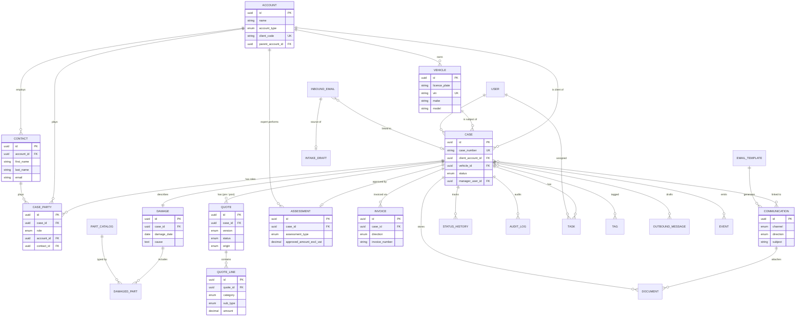
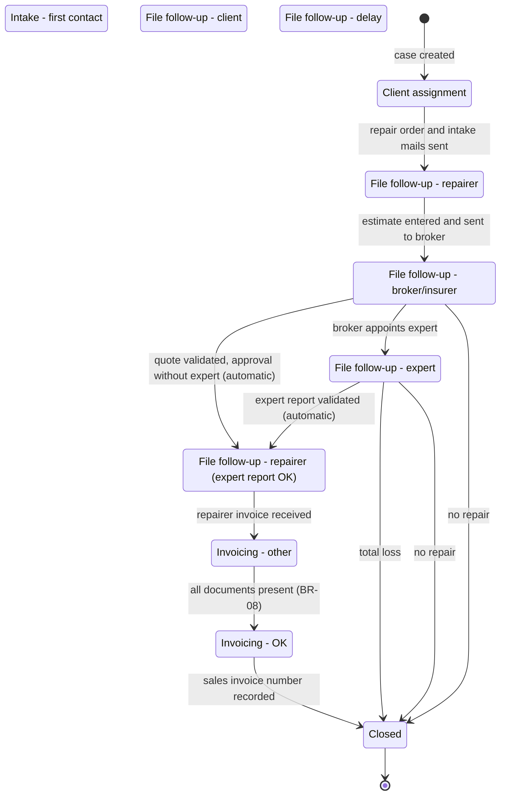
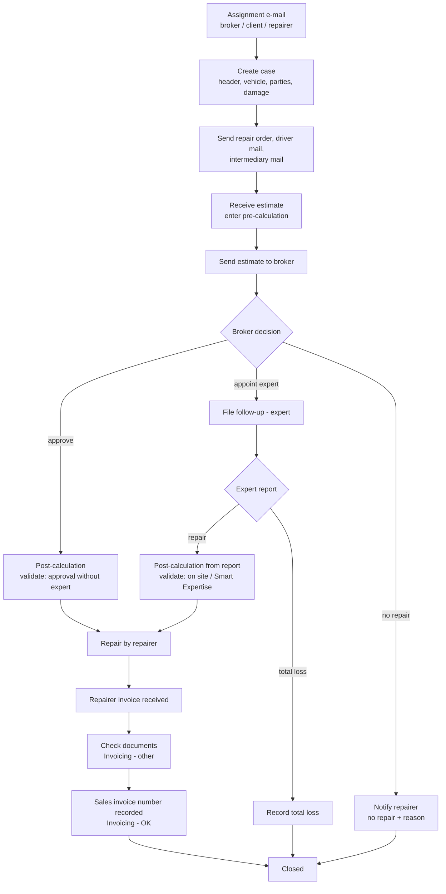
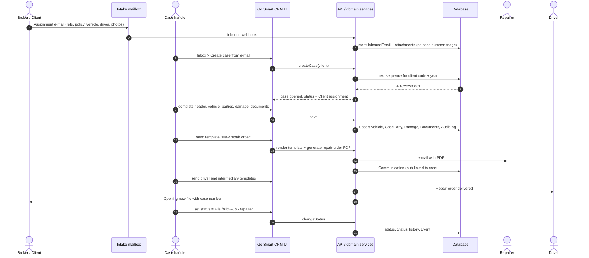
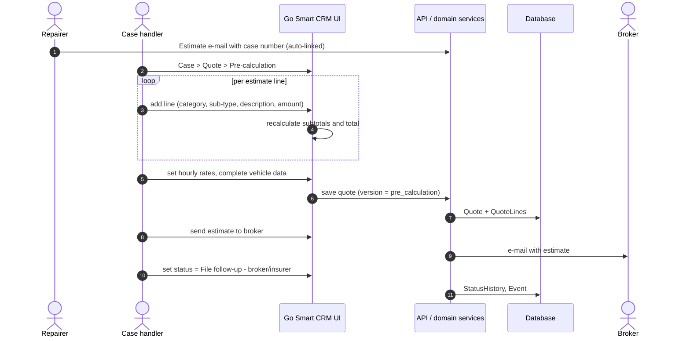
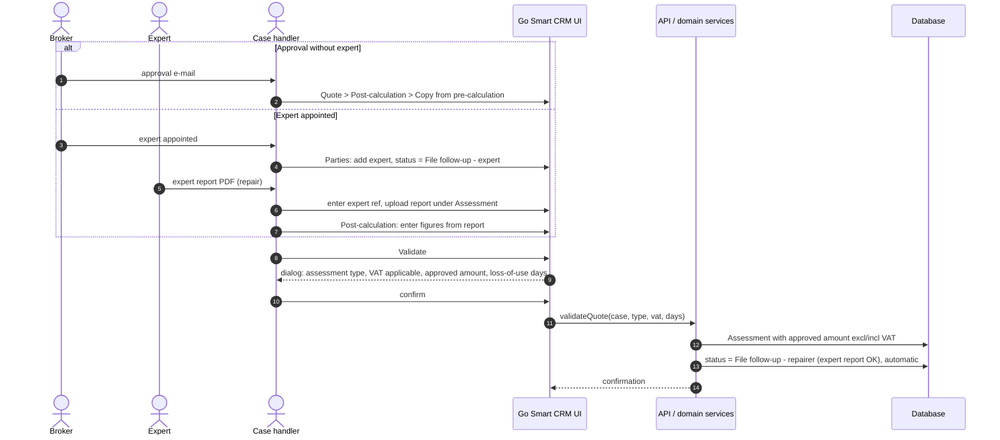
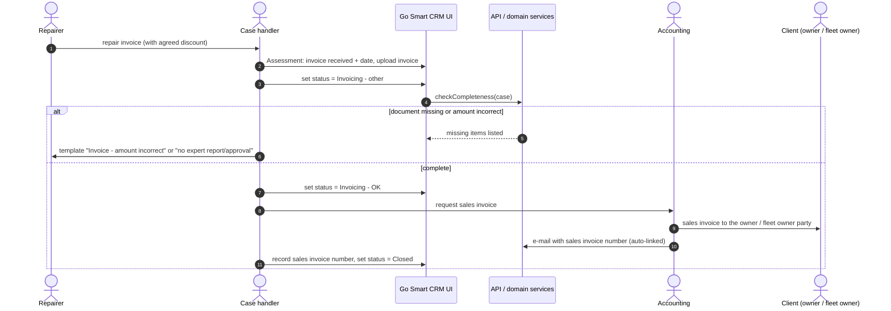
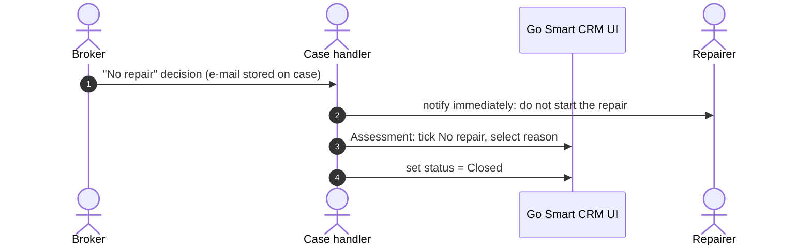
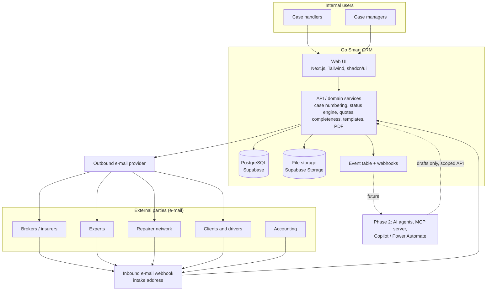

# Go Smart CRM – Design

This document defines the data model, case lifecycle, main sequences and solution architecture for the requirements in `requirements.md`.

## 1. Data model

### 1.1 Entity relationship diagram

All organisations (client, broker, insurer, expert, repairer, leasing company, supplier, third party) are one **Account** object with a type. People are **Contacts** under an Account. A **Case** links one Vehicle and one client Account, and has party roles, one Damage, up to two Quote versions, an Assessment, Invoices, Communications and Documents.

The diagram shows key attributes only. Full attribute lists follow. Every table also has `created_at`, `updated_at`, `created_by` and `updated_by`.

### 1.2 Account

| Field | Type | Notes |
| --- | --- | --- |
| id | uuid, PK | |
| name | text | |
| account_type | enum (multi-value) | client, broker, insurer, expert, repairer, leasing_company, supplier, third_party |
| client_code | text (3–4), unique | Case-number prefix; clients only |
| parent_account_id | FK Account | Groups of companies |
| vat_number | text | |
| vat_liable | boolean | |
| address_line1, address_line2, postcode, city, country | text | |
| phone, email | text | |
| invoicing_conditions | text | Printed on the repair order (BR-09) |
| discount_pct | decimal | Repairer discount agreement (BR-09) |
| requires_vda_po | boolean | Client needs VDA and PO references (BR-11) |
| is_network_member | boolean | Repairer belongs to the repair network |

### 1.3 Contact

| Field | Type | Notes |
| --- | --- | --- |
| id | uuid, PK | |
| account_id | FK Account | Employer organisation |
| salutation | text | |
| first_name, last_name | text | |
| email | text | |
| phone | text | |

### 1.4 Vehicle

| Field | Type | Notes |
| --- | --- | --- |
| id | uuid, PK | |
| licence_plate | text, indexed | Not unique over time |
| vin | text (17), unique | Chassis number |
| first_registration_date | date | |
| make, model | text | |
| model_year | integer | |
| type_designation | text | |
| category | enum | e.g. electric, hybrid, diesel, petrol, light van |
| colour, paint_type | text | |
| owner_account_id | FK Account | Fleet owner |
| leasing_account_id | FK Account | |
| power_kw, engine_cc, co2, seats | integer | Optional; often taken from expert reports |

### 1.5 Case

| Field | Type | Notes |
| --- | --- | --- |
| id | uuid, PK | |
| case_number | text, unique | Client code + YYYY + 4-digit sequence (BR-01) |
| client_account_id | FK Account | |
| vehicle_id | FK Vehicle | |
| status | enum | See section 2 |
| manager_user_id | FK User | Case manager |
| assigned_to_user_id | FK User | |
| insurer_ref, broker_ref, expert_ref, leasing_ref | text | |
| vda_number, po_number | text | Client-specific references (BR-11) |
| policy_number, cover_type | text | |
| vat_liable_pct | decimal | e.g. 35% |
| deductible | decimal | |
| assignment_date, completion_date, collected_date, delivered_date | date | |
| appointment_estimate_at, appointment_repair_at | timestamp | |
| vehicle_in_date, vehicle_ready_date, client_notified_date, vehicle_out_date | date | |
| on_hold | boolean | |
| on_hold_reason | enum + text | |
| repair_decision | enum | repair, no_repair, total_loss |
| no_repair_reason | enum + text | |

### 1.6 Case party

| Field | Type | Notes |
| --- | --- | --- |
| id | uuid, PK | |
| case_id | FK Case | |
| role | enum | owner_fleet_owner, leasing_company, driver, insured_tenant, insurer, intermediary, third_party, expert, repairer |
| account_id | FK Account | For organisations |
| contact_id | FK Contact | For people |
| is_invoice_party | boolean | True for owner_fleet_owner (BR-02) |

### 1.7 Damage and damaged parts

| Field | Type | Notes |
| --- | --- | --- |
| id | uuid, PK | One per case |
| case_id | FK Case | |
| damage_date | date | |
| mileage_in, mileage_out | integer | |
| address_line1, address_line2, postcode, city, country | text | Damage location |
| cause | text | |
| liability | enum | |
| circumstances | enum | |
| extra_info | text | |
| **DamagedPart** (damage_id, part_code) | join table | Part catalog: rear/front bumper; rear/front door left/right; bonnet; roof; boot; front/rear wing left/right; headlight left/right; side mirror left/right; side windows front/rear left/right; rear window; windscreen; tail light left/right; wheel rims and tyres front/rear left/right |

### 1.8 Quote and quote line

| Field | Type | Notes |
| --- | --- | --- |
| id | uuid, PK | |
| case_id | FK Case | |
| version | enum | pre_calculation, post_calculation |
| origin | enum | repairer, expert, manual, ai (phase 2) |
| status | enum | draft, pending_review, validated, rejected, sent |
| copied_from_quote_id | FK Quote | "Copy from pre-calculation" |
| hourly_rate_paint, hourly_rate_assembly | decimal | |
| total_excl_vat | decimal | Derived from lines |
| generated_by, model_version, rationale | text | Phase-2 hooks, empty in version 1 |
| **QuoteLine** category | enum | labour, parts, paint_products, smart_repair, other_costs, fixed_price, deduction |
| **QuoteLine** sub_type | enum | Labour: assembly_disassembly, paintwork, panel_work, preparation, finishing. Other costs: environmental_fee, anti_rust, small_parts, polishing, covid_flat_fee, cavity_protection, diagnostics, miscellaneous. Deduction: previous_claim, wear_and_tear |
| **QuoteLine** description, amount | text, decimal | Deductions are negative |
| **QuoteLine** source_refs | jsonb | Phase-2 hook |

### 1.9 Assessment

| Field | Type | Notes |
| --- | --- | --- |
| id | uuid, PK | One per case |
| case_id | FK Case | |
| assessment_type | enum | none, on_site, smart_expertise, approval_without_expert |
| expert_account_id | FK Account | |
| vat_applicable | boolean | |
| approved_amount_excl_vat, approved_amount_incl_vat | decimal | |
| loss_of_use_days | integer | BR-05 |
| expert_report_document_id | FK Document | |
| total_loss_vehicle_value, total_loss_previous_damage_deduction, total_loss_accessories, total_loss_wreck_value, total_loss_damage_amount | decimal | UC-26 |
| validated_at, validated_by | timestamp, FK User | |

### 1.10 Invoice

| Field | Type | Notes |
| --- | --- | --- |
| id | uuid, PK | |
| case_id | FK Case | |
| direction | enum | purchase (repairer → company), sales (company → client) |
| received | boolean | Repairer invoice |
| received_date | date | |
| invoice_number | text | Sales invoice number from accounting |
| amount_excl_vat | decimal | |
| document_id | FK Document | |

### 1.11 Communication, e-mail template, document

| Object | Fields |
| --- | --- |
| Communication | id, channel (email, phone, other), direction (in, out), subject, body (rich text), from, to, cc, bcc, sent_at, processed (boolean), template_id, language; many-to-many with Case (BR-12) |
| EmailTemplate | id, code, name, audience, language, subject, body with merge fields. Initial set: new repair order (repairer); general outgoing mail; driver information; driver information – repair order delivered; expert – information on expert appointment; new repair order – opening new file → intermediary; new repair order – repairer follow-up; invoice – no expert report/approval; invoice – amount incorrect |
| Document | id, case_id (nullable for shared documents), file_name, size, mime_type, category (claim_form, photo, estimate, expert_report, invoice, repair_order, purchase_order, generated, other), storage_path |

### 1.12 Supporting objects

| Object | Fields |
| --- | --- |
| User | id, username, full_name, email, signature |
| Task | id, title, category (my_tasks, repairer_dealer, fleet_insurer, supplier, broker), due_date, assignee_user_id, case_id, done |
| StatusHistory | id, case_id, from_status, to_status, changed_at, changed_by, automatic (boolean) |
| AuditLog | id, entity, entity_id, field, old_value, new_value, actor_type (user, system, agent), actor_id, at |
| Tag / CaseTag | id, name / case_id, tag_id |
| Lookups | on_hold_reason, no_repair_reason, liability, circumstances, part_catalog |

### 1.13 Intake and automation objects (phase-2 hooks)

| Object | Fields |
| --- | --- |
| InboundEmail | id, message_id, from, to, cc, subject, body_text, body_html, received_at, raw_storage_path, parse_status (new, linked, triage, converted, ignored), linked_case_id |
| InboundAttachment | id, inbound_email_id, file_name, mime_type, size, storage_path |
| IntakeDraft | id, source_email_id, proposed_fields (jsonb), field_confidence (jsonb), missing_fields (text[]), status (draft, in_review, accepted, rejected), case_id (after acceptance) |
| OutboundMessage | id, case_id, template_id, merge_data (jsonb), to, cc, subject, body, status (draft, approved, sent, failed), approved_by, sent_at |
| Event | id, type (case.created, status.changed, email.received, quote.validated, message.sent), case_id, payload (jsonb), created_at, delivered (boolean) |
| ApiClient | id, name, scopes (text[]), key_hash, active |

## 2. Case lifecycle

Users can set any status manually from the status dropdown. The application sets the status automatically in one place: validating a quote (BR-03). The diagram shows the standard path; statuses without arrows (intake, client follow-up, delay) are set manually when they apply.

End-to-end flow:

## 3. Sequence diagrams

### 3.1 Create a case

### 3.2 Create a quote

### 3.3 Approve the quote, with or without an expert

### 3.4 Invoice and close a case

### 3.5 No repair

## 4. Solution architecture

| Component | Responsibility |
| --- | --- |
| Web UI | Left menu (Home; CRM: Dashboard, Accounts, Contacts, Tasks, Leads, Notes, Surveys; Damage claims: Cases, Inbox; Repairs: Dashboard, Network, Cases; Documents). Case screen with tabs: Case, Vehicle, Parties, Damage, Quote, Assessment, Communications, Documents, History. Save / Close buttons; warning marker on incomplete tabs |
| API / domain services | Case numbering, status engine (manual changes + automatic transition BR-03), quote totals and validation, completeness checks (BR-08), template rendering and repair-order PDF, inbound e-mail matching (BR-10) |
| Database | All objects in section 1, with row-level security |
| File storage | Photos, PDFs, raw e-mails, generated documents |
| Event table + webhooks | case.created, status.changed, email.received, quote.validated, message.sent, for future integrations |
| Outbound e-mail | Sends templated e-mails and records them as Communications |
| Inbound e-mail webhook | Receives e-mails sent or forwarded to the intake address, stores them as InboundEmail, links them by case number or routes them to the Inbox |
